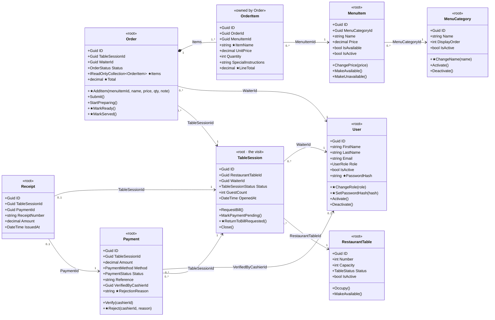
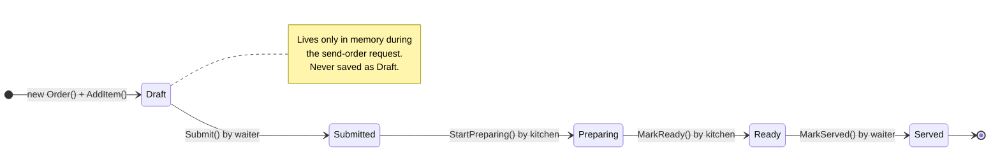
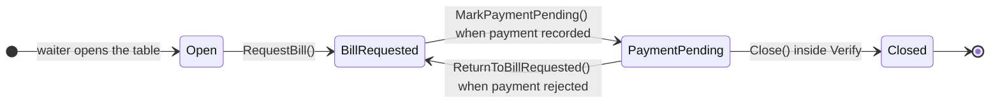
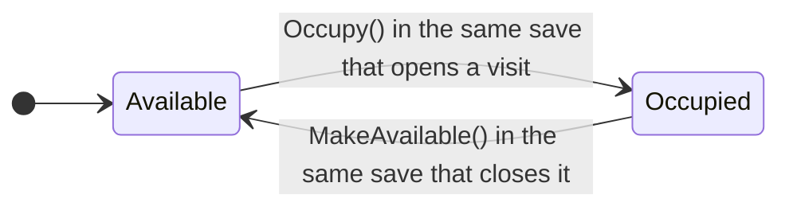
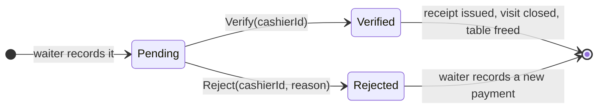

# Domain diagrams

The domain model in pictures: the classes and how they refer to each other, and the state machine of every record that changes status. The rules in words are in [DOMAIN_MODEL.md](DOMAIN_MODEL.md); the tables are in [ERD.md](ERD.md).

The diagrams are Mermaid. PNG copies are in [diagrams/](diagrams/).

## 1. Class diagram

Entities refer to each other **by ID** (`WaiterId`, `TableSessionId`…), not by navigation properties. The one exception is `Order`, which owns its lines through `Items`. An arrow points from the class holding the ID to the class it names. **★ marks a member added or changed in WBS 1.2** (a new field, a renamed method or a bug fix).

<!-- diagram: domain-classes -->

**Roots and ownership:** each `<<root>>` is loaded and saved on its own. `OrderItem` is created only through `Order.AddItem()` and saved with its order. Enum values are listed in [ENTITIES.md](ENTITIES.md#enums-make-every-value-explicit-wbs-12).

## 2. State machines

Every arrow is a domain method. Any transition that isn't drawn throws `DomainException`, which the API returns as 409.

### Order

<!-- diagram: state-order -->

`Collected` stays in the enum but is skipped in v1.

### Visit (TableSession)

<!-- diagram: state-visit -->

### Table (RestaurantTable)

<!-- diagram: state-table -->

### Payment

<!-- diagram: state-payment -->

`Failed` stays in the enum but is unused in v1.

## 3. How the states move together

One sale, step by step. Each row is one request and one save; a dash means the record doesn't exist yet.

| Step (who) | Table | Visit | Order | Payment | Receipt |
| --- | --- | --- | --- | --- | --- |
| Open visit (waiter) | **Occupied** | **Open** | — | — | — |
| Send order (waiter) | Occupied | Open | **Submitted** | — | — |
| Start (kitchen) | Occupied | Open | **Preparing** | — | — |
| Ready (kitchen) | Occupied | Open | **Ready** | — | — |
| Serve (waiter) | Occupied | Open | **Served** | — | — |
| Request bill (waiter) | Occupied | **BillRequested** | Served | — | — |
| Record payment (waiter) | Occupied | **PaymentPending** | Served | **Pending** | — |
| *Reject (cashier)* | Occupied | **BillRequested** | Served | **Rejected** | — |
| *Record again (waiter)* | Occupied | **PaymentPending** | Served | **Pending** (new) | — |
| Verify (cashier) | **Available** | **Closed** | Served | **Verified** | **Issued** |

Bold marks what that step changed. The last row is the all-or-nothing save described in the [payment doc](RestaurantPOS-Payment-Receipt-Mental-Model.md#4-verify-the-all-or-nothing-step-wbs-52).
