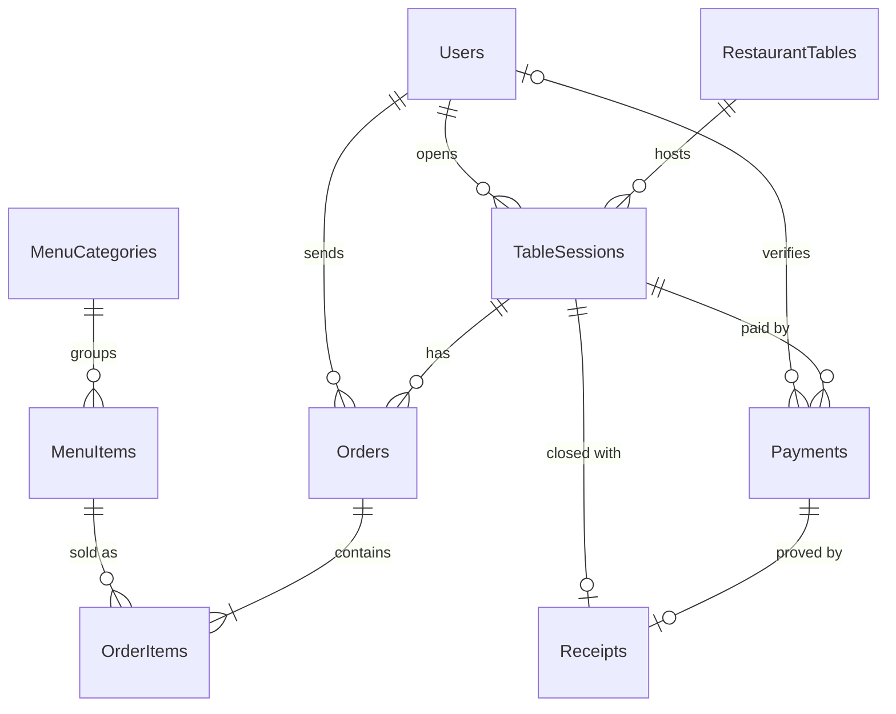
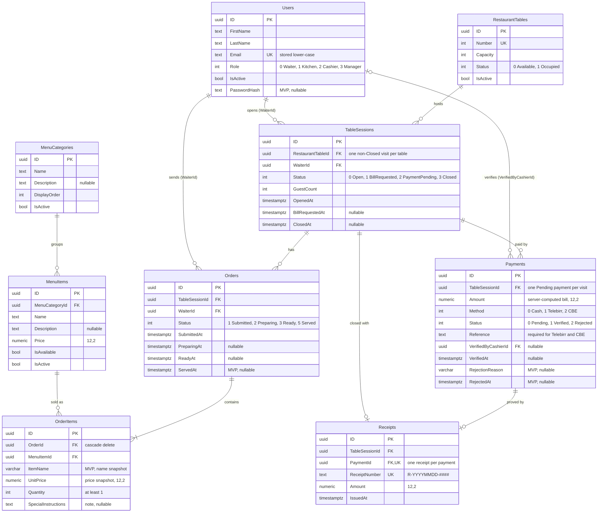
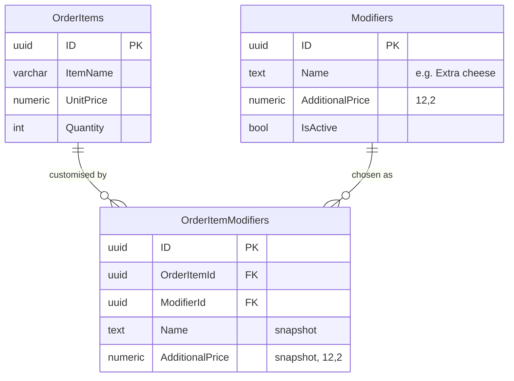

# Entity-relationship diagrams (ERD)

The PostgreSQL schema the MVP runs on: the tables from `InitialCreate` plus the WBS 1.3 `MvpIntegrity` migration. Field-by-field notes are in [ENTITIES.md](ENTITIES.md); the rules behind the keys are in [DOMAIN_MODEL.md](DOMAIN_MODEL.md).

The diagrams are Mermaid, so GitHub and VS Code (with a Mermaid preview extension) draw them from the text below. PNG copies are in [diagrams/](diagrams/); regenerate them after you edit a diagram (see [How to regenerate the PNGs](#how-to-regenerate-the-pngs)).

## 1. At a glance

Nine tables carry the whole sale. The visit (`TableSessions`) is in the middle: orders hang off it on one side and payments on the other.

<!-- diagram: erd-overview -->


**How to read the crow's feet:** `||` means exactly one, `|o` zero or one, `|{` one or more, and `o{` zero or more. So "Orders `||--|{` OrderItems" means every line belongs to one order, and an order has at least one line.

## 2. Full MVP schema

Every table also has `CreatedAt` and `UpdatedAt` (timestamptz), which are left out of the diagram to save space. Money columns are `numeric(12,2)`. Enum columns store integers; the comment shows the values.

<!-- diagram: erd-mvp -->


## 3. Keys that protect money and data

These are the constraints that do real work. The partial indexes are what stop double-clicks and races; see [DOMAIN_MODEL.md §6](DOMAIN_MODEL.md#6-invariants-and-who-enforces-them).

| Table | Constraint | Stops |
| --- | --- | --- |
| TableSessions | Unique `RestaurantTableId` where `Status <> 3` | Two open visits on one table |
| Payments | Unique `TableSessionId` where `Status = 0` | Two pending payments for one visit |
| Receipts | Unique `PaymentId` | Two receipts for one payment (double-click on Verify) |
| Receipts | Unique `ReceiptNumber` | Duplicate receipt numbers |
| RestaurantTables | Unique `Number` | Two "Table 3"s |
| Users | Unique `Email` | Two accounts with one login |
| All foreign keys | `Restrict` on delete (OrderItems → Orders cascades) | Deleting a menu item, table or user that history points to |

Table names assume EF's defaults from your `DbSet` property names. Check `InitialCreate` for the real names, and rename them here if they differ.

## 4. v2 extension: modifiers

These two tables already exist but stay unused in v1 (decision D-03). When modifiers come back, a line can carry customisations, each with its own name and price snapshot.

<!-- diagram: erd-v2-modifiers -->


In v2: `LineTotal = (UnitPrice + Σ AdditionalPrice) × Quantity`.

## How to regenerate the PNGs

```powershell
npm i -g @mermaid-js/mermaid-cli
# copy one mermaid block into a file, then:
mmdc -i erd-mvp.mmd -o docs/diagrams/erd-mvp.png -b white -s 2
```
