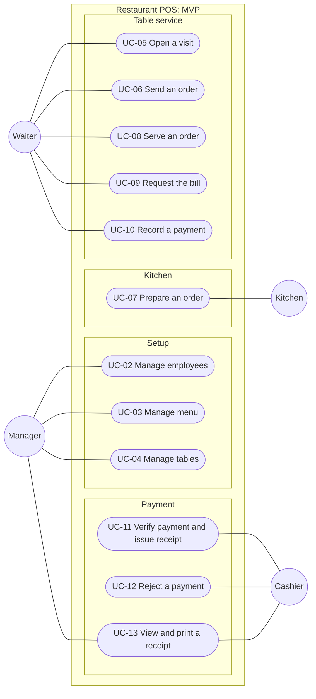
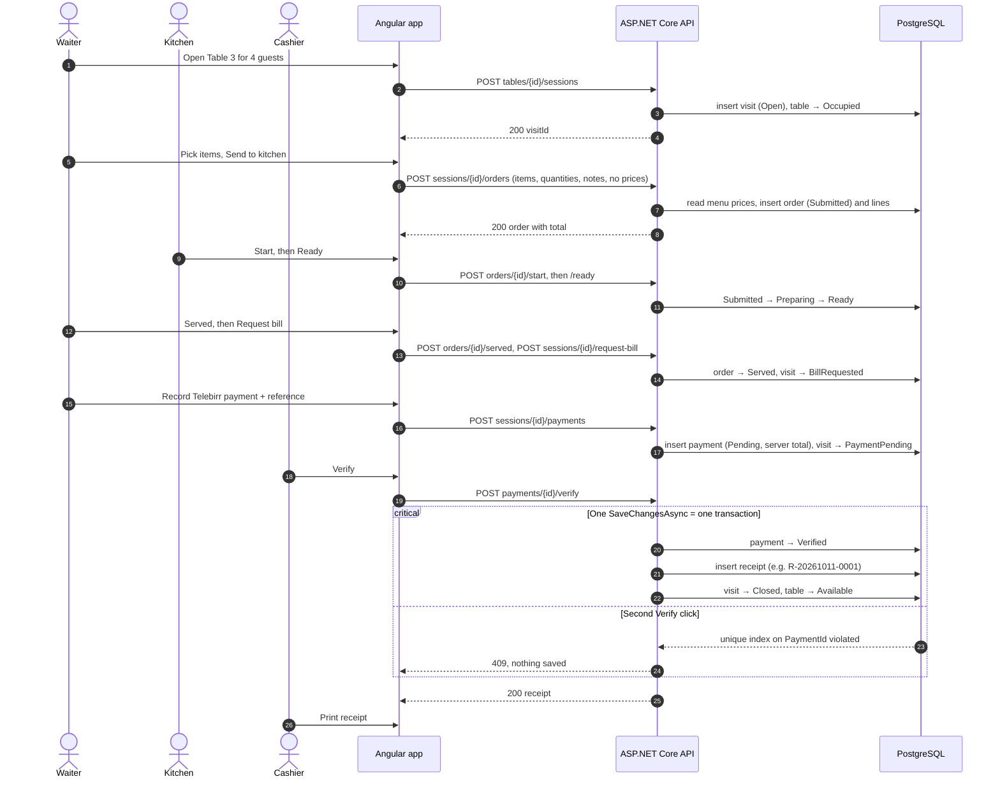

# Use cases (MVP)

Thirteen use cases cover the whole MVP. Each one maps to WBS rows in the [build plan](BUILD_PLAN.md), an endpoint, and a screen. The domain rules they rely on are in [DOMAIN_MODEL.md](DOMAIN_MODEL.md); the decisions (D-01…D-09) are in [README.md](README.md#mvp-decisions-wbs-11).

## 1. Use case diagram

Four staff actors, one system. The customer never touches the software: they talk to the waiter and pay at the cashier. Every actor signs in first (UC-01); it is left out of the picture so the lines stay readable.

<!-- diagram: use-case-diagram -->

## 2. Catalog

| ID | Use case | Actor | WBS | Endpoint (under `/api`) | Screen |
| --- | --- | --- | --- | --- | --- |
| UC-01 | Sign in | All | 2.1, 2.2 | `POST auth/login`, `GET auth/me` | `/login` |
| UC-02 | Manage employees | Manager | 2.3 | `GET, POST employees`, `PUT employees/{id}/role`, `POST employees/{id}/deactivate` | `/manager/employees` |
| UC-03 | Manage menu | Manager | 3.1, 3.2 | `GET, POST categories`, `PUT categories/{id}`, `GET, POST items`, `PUT items/{id}`, `POST items/{id}/availability` | `/manager/menu` |
| UC-04 | Manage tables | Manager | 3.3 | `GET, POST tables` | `/manager/tables` |
| UC-05 | Open a visit | Waiter | 3.3, 3.4 | `GET tables/board`, `POST tables/{id}/sessions` | `/waiter/tables` |
| UC-06 | Send an order | Waiter | 4.1, 4.2 | `GET menu`, `GET sessions/{id}`, `POST sessions/{id}/orders` | `/waiter/sessions/:id` |
| UC-07 | Prepare an order | Kitchen | 4.3, 4.4 | `GET kitchen/orders`, `POST orders/{id}/start`, `POST orders/{id}/ready` | `/kitchen` |
| UC-08 | Serve an order | Waiter | 4.1, 4.2 | `POST orders/{id}/served` | `/waiter/sessions/:id` |
| UC-09 | Request the bill | Waiter | 5.1 | `POST sessions/{id}/request-bill`, `GET sessions/{id}/bill` | `/waiter/sessions/:id` |
| UC-10 | Record a payment | Waiter | 5.2 | `POST sessions/{id}/payments` | `/waiter/sessions/:id` |
| UC-11 | Verify payment and issue receipt | Cashier | 5.2, 5.3 | `GET payments/pending`, `POST payments/{id}/verify` | `/cashier` |
| UC-12 | Reject a payment | Cashier | 5.2, 5.3 | `POST payments/{id}/reject` | `/cashier` |
| UC-13 | View and print a receipt | Cashier, Manager | 5.3 | `GET receipts/{id}` | `/receipts/:id` |

## 3. Use case specifications

Every use case except UC-01 has the same precondition: the actor is signed in with the role shown, and the API rejects any other role with 403. Error codes follow [IMPLEMENTATION_GUIDE.md §5](IMPLEMENTATION_GUIDE.md#5-errors).

### UC-01 Sign in

- **Actor:** any employee · **Goal:** reach the screens for their role.
- **Main flow:**
  1. Employee enters email and password.
  2. System checks the password hash and that the account is active.
  3. System returns a token (valid 8 h) and the employee's name and role.
  4. App opens the role's home screen (Waiter → tables, Kitchen → board, Cashier → pending payments, Manager → menu).
- **Errors:** wrong email, wrong password or inactive account → 401 with one generic message.
- **After:** every request carries the token; a 401 later sends the user back to the login screen.

### UC-02 Manage employees

- **Actor:** Manager · **Goal:** give each staff member their own account.
- **Main flow:**
  1. Manager opens the employee list.
  2. Manager creates an employee: name, email, role and a temporary password.
  3. Manager can change an employee's role or deactivate them.
- **Errors:** duplicate email → 409 · demoting or deactivating the last active Manager → 409.
- **After:** the new employee can sign in (UC-01). A deactivated employee can't sign in again; any token they already hold expires within 8 h (D-09).

### UC-03 Manage menu

- **Actor:** Manager · **Goal:** keep what can be sold, and at what price, up to date.
- **Main flow:**
  1. Manager creates or renames categories and sets their display order.
  2. Manager creates items in an active category with a name, description and price.
  3. Manager changes prices and toggles availability ("sold out today") or active state.
- **Errors:** blank name or negative price → 400 · new item in an inactive category → 409.
- **After:** waiters see only active and available items (`GET menu`). Price changes don't affect orders already sent (snapshot rule).

### UC-04 Manage tables

- **Actor:** Manager · **Goal:** the floor plan matches the room.
- **Main flow:** Manager adds tables with a number and capacity, and can deactivate one.
- **Errors:** duplicate table number → 409.
- **After:** active tables appear on the waiter's board as Available.

### UC-05 Open a visit

- **Actor:** Waiter · **Goal:** start serving a group at a free table.
- **Precondition:** the table is active and Available.
- **Main flow:**
  1. Waiter sees the table board (Available and Occupied tables).
  2. Waiter picks a free table and enters the guest count.
  3. System creates the visit (Open, owned by this waiter) and marks the table Occupied, in one save.
  4. App opens the visit page.
- **Errors:** someone opened the table a moment earlier → 409 "already open", and the board refreshes · guest count below 1 → 400.
- **After:** one Open visit exists for the table.

### UC-06 Send an order

- **Actor:** Waiter · **Goal:** get the guests' food to the kitchen at the right price.
- **Precondition:** the visit is Open and belongs to this waiter.
- **Main flow:**
  1. Waiter picks items by category and sets the quantity and an optional note per line.
  2. Waiter taps **Send to kitchen**.
  3. System copies each item's current name and price onto its line, creates the order and submits it, in one save.
  4. App shows the order as Submitted with its total. The kitchen board shows it within 5 s.
- **Errors:** empty cart → Send is disabled (the API returns 409 if called anyway) · an item became unavailable → 409, and the waiter removes it · another waiter's visit → 403 · bill already requested → 409.
- **After:** a Submitted order with at least one line and frozen prices. The waiter can send more orders on the same visit.

### UC-07 Prepare an order

- **Actor:** Kitchen · **Goal:** cook orders in arrival order and tell the waiter when they're ready.
- **Main flow:**
  1. Kitchen board shows New (Submitted), Preparing and Ready columns, oldest first, refreshing every 5 s.
  2. Cook taps **Start** → Preparing.
  3. Cook taps **Ready** → Ready.
- **Errors:** two cooks tap the same order → the second gets 409 and the board refreshes.
- **After:** the waiter sees the order as Ready on the visit page.

### UC-08 Serve an order

- **Actor:** Waiter · **Goal:** record that the food reached the table.
- **Precondition:** the order is Ready, on the waiter's own visit.
- **Main flow:** waiter taps **Served**, and the order moves to Served.
- **Errors:** the order isn't Ready yet → 409 · another waiter's visit → 403.

### UC-09 Request the bill

- **Actor:** Waiter · **Goal:** show the guests what they owe.
- **Precondition:** the visit is Open and belongs to this waiter.
- **Main flow:**
  1. Waiter taps **Request bill**.
  2. System moves the visit to BillRequested and returns the bill: every line of every order, and the total from the line snapshots.
- **Errors:** visit not Open → 409.
- **After:** no new orders can be sent on this visit.

### UC-10 Record a payment

- **Actor:** Waiter · **Goal:** hand the cashier a payment to check.
- **Precondition:** the visit is BillRequested and belongs to this waiter.
- **Main flow:**
  1. Waiter picks the method: Cash, Telebirr or CBE.
  2. For Telebirr or CBE, waiter types the transaction reference.
  3. System creates a Pending payment for the full bill total (computed on the server) and moves the visit to PaymentPending, in one save.
- **Errors:** Telebirr or CBE without a reference → 409 · a Pending payment already exists (double tap) → 409.
- **After:** the payment appears in the cashier's pending list.

### UC-11 Verify payment and issue receipt

- **Actor:** Cashier · **Goal:** confirm the money arrived and close the visit.
- **Precondition:** the payment is Pending.
- **Main flow:**
  1. Cashier opens the pending list and checks the cash, or finds the reference in the Telebirr or CBE app.
  2. Cashier taps **Verify**.
  3. In one save, the system marks the payment Verified (recording the cashier from their token), issues a receipt numbered `R-YYYYMMDD-####`, closes the visit and frees the table.
  4. App opens the receipt (UC-13).
- **Errors:** Verify clicked twice, or two cashiers at once → the second gets 409 and no second receipt is created.
- **After:** exactly one receipt; the visit is Closed; the table is Available for the next guests.

### UC-12 Reject a payment

- **Actor:** Cashier · **Goal:** stop a payment that can't be confirmed.
- **Precondition:** the payment is Pending.
- **Main flow:**
  1. Cashier taps **Reject** and enters a reason (for example "reference not found").
  2. System marks the payment Rejected with the reason and time, and moves the visit back to BillRequested.
- **After:** the waiter sees the rejection reason and records a new payment (UC-10).

### UC-13 View and print a receipt

- **Actors:** Cashier, Manager · **Goal:** give the guest proof of payment.
- **Main flow:** open the receipt, then tap **Print** (`window.print()`, using the print stylesheet).
- **Shows:** receipt number, table, date and time, lines with quantity and price, total, payment method and reference, and the cashier who verified it.
- **Errors:** unknown receipt → 404.

## 4. The whole sale, as a sequence

How UC-05 to UC-11 run through the system for one table. Polling and the Manager's setup are left out.

<!-- diagram: sequence-full-sale -->

